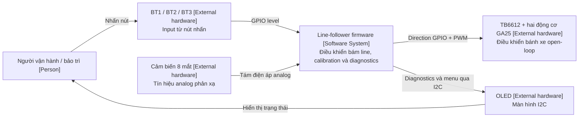
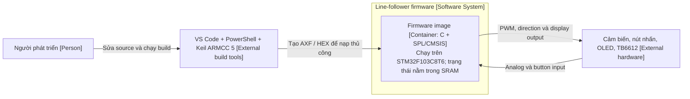
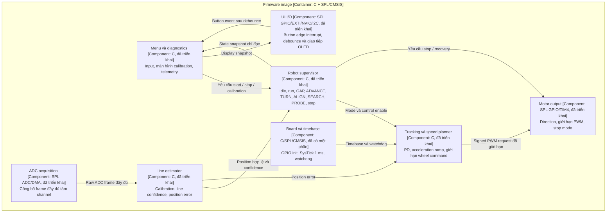
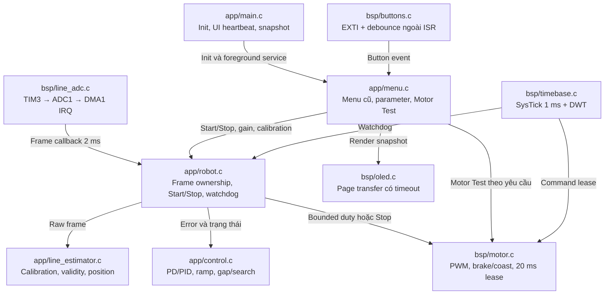
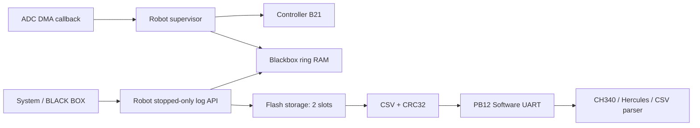

> **B29 hiện tại:** Giữ Base45/Max85 và PID nền12/0/0,12. ExtraP lên nhanh hơn, nhả sớm sau6ms error về tâm; xác nhận tăng lại để tránh bật/tắt do một mẫu nhiễu. Mốc ownerB28:16,3giây;55/60 từng chậm hơn45. Xem [B29](corner-return-b29.md). Chưahardware-verified; policy cũ bên dưới là lịch sử khi mâu thuẫn.

> **B28 hiện tại:** Base45/Max85, PID nền12/0/0,12. Tăng P từ từ ở confirmed visible corner trước khi mất line; search50 trên trắng,36 khi có tín hiệu, nhậnPD ngay khi valid. Giữ B27 arc/nét đứt/driver. Đã so ba candidate bằng command trace; chưa hardware-verified. Xem [B28](visible-corner-b28.md); policy cũ bên dưới là lịch sử khi mâu thuẫn.

> **B27 hiện tại:** Base45/Max85, PID12/0/0,12; rẽ tiến bằng PWM đang có trong28ms đầu recovery rồi mới pivot nếu còn mất line. Nhận line ngay, bảo vệ retry góc vuông; lọc hướng GAP và stagger đảo chiều để tránh both-wheel zero khi retarget. Xem [B27](rolling-corner-b27.md). Chưa hardware-verified; các policy cũ bên dưới là lịch sử khi mâu thuẫn.

> **B26 hiện tại:** Base45/Max85, PID12/0/0,12; TRACK cố định, P phản ứng ngay khi có line, rejoin giữ duty dưới cap40. Giữ recovery/góc vuông/nét đứt có giới hạn. Thêm cấu hình SWD rõ ràng và hướng dẫn lỗi nạp Keil. Xem [B26](corner-flow-b26.md) và [Keil/ST-Link](keil-download.md). **Chưa hardware-verified**; các policy cũ bên dưới là lịch sử khi mâu thuẫn.

> **B25 hiện tại:** TRACK dùng Base cố định, bỏ boost/Straight và steering floor B24. Mất line sau góc đã xác nhận chuyển TURN trực tiếp; sửa lỗi sai số giữa ±0,5 làm đảo hướng tìm line. Giữ GAP, RECENTER/post-turn và watchdog. Mặc định Base55/Max85, PID12/0/0,12; PID Setup có5 dòng. Xem [hướng dẫn B25](fixed-base-b25.md). **Chưa hardware-verified**; các chính sách cũ bên dưới là lịch sử khi mâu thuẫn.

> **B24 hiện tại:** bỏ xung BRAKE trước recovery; TURN trộn common/steering để tạo yaw ngay, valid corner có steering floor và bỏ cap32 do shape đơn thuần; reversal guard theo từng bánh. CORNER chờ cue có hướng/TURN/fault. Profile55/60/85, PID12/0/0,12. Xem [B24](speed-b24.md). Chưa hardware-verified; policy cũ bên dưới là lịch sử khi mâu thuẫn.

> **B23 hiện tại:** sửa PROBE15 theo log thật: continuation tối đa32ms khi có guide giữa ổn định, cap32%, không tăng duty khi invalid; cue rẽ/memory/recovery có ưu tiên. Profile55/60/85, PID12/0/0,12. Xem [B23](speed-b23.md). Chưa hardware-verified; policy cũ bên dưới là lịch sử khi mâu thuẫn.

> **B22 hiện tại:** hộp đen RAM → Save Flash khi dừng → Export CSV qua PB12/CH340, 9600 8N1. Vào **6. System → N2: BLACK BOX**. Controller B21 giữ nguyên; không tự tối ưu PID. Xem [hướng dẫn B22](blackbox-b22.md). Chưa hardware-verified; nội dung cũ bên dưới là lịch sử khi mâu thuẫn.

> **B21 hiện tại:** bỏ ENTRY_BRAKE khi line valid; tiếp tục forward PID và giảm PWM mượt ở cua mềm, giữ phanh khi mất line nhanh và bảo vệ chuỗi góc vuông. Profile 55/60/85, PID 12/0/0,12. Xem [B21](speed-b21.md). Các policy cũ bên dưới là lịch sử khi mâu thuẫn. Chưa hardware-verified.

> **B20 hiện tại:** 55/60/85, PID12/0/0,12; làm mượt correction có điều kiện, ENTRY BRAKE8ms khi góc đã xác nhận sau thẳng nhanh, cap35 khi xác nhận lại tâm60ms. Thêm STEER sau TIME. Xem [B20](speed-b20.md). Chưa hardware-verified; policy cũ bên dưới là lịch sử khi mâu thuẫn.

> **Cập nhật B09:** owner chọn Base cruise, bỏ boost/cooldown; thêm guide memory để giữ L/R qua GAP. Xem [cruise-gap-b09.md](cruise-gap-b09.md) và [runtime.md](runtime.md). Không dùng ADVANCE/geometry timing; nội dung phiên bản cũ bên dưới là lịch sử.

# Kiến trúc phần mềm theo C4

Kiến trúc dùng [C4 model](https://c4model.com/diagrams), gồm System Context, Container, Component và Code.
Sơ đồ được viết bằng Mermaid flowchart, ghi rõ loại phần tử C4, công nghệ, boundary và quan hệ.
Thiết bị phần cứng nằm ngoài software-system boundary, không phải software container.
Container ở đây là ứng dụng có thể chạy độc lập; thuật ngữ này không yêu cầu dùng Docker.

## Level 1: System Context

Phạm vi: firmware xe dò line được xem là một Software System.
Menu, sensor acquisition và motor control đã triển khai. Owner xác nhận RUN bám vòng tròn/cua nhẹ; B03 xử lý cua gấp/nét đứt mới chưa kiểm chứng trên xe.

## Level 2: Container

Phạm vi: Software System của firmware, gồm một ứng dụng bare-metal có thể deploy.
SPL và CMSIS là thư viện được link bên trong ứng dụng, không phải container độc lập.
Máy build là công cụ phát triển bên ngoài, không phải runtime service trên xe.

Chưa triển khai hoặc chốt thiết kế lưu calibration vào internal Flash.
Không có operating system, network service, external database hoặc container cung cấp encoder feedback.

## Level 3: Component trong firmware

Các component đã có source. Supervisor và controller mới chạy theo frame 2 ms; tuning và timing trên phần cứng vẫn cần kiểm chứng. Xem [run-test.md](run-test.md).
Tên component mô tả trách nhiệm, không khẳng định đã có source file hay API tương ứng.

Ba nút dùng GPIO → EXTI → NVIC để phát hiện cạnh; debounce và nhấn ngắn/nhấn giữ xử lý ngoài ISR theo elapsed time. Không dùng polling để phát hiện nhấn/nhả. Xem thiết kế chi tiết trong [runtime.md](runtime.md). Driver nút đã triển khai; owner đã thao tác calibration/Motor Test trên mạch.

Supervisor quản lý mode transition; controller không được coi mọi mẫu mất line là ngõ cụt.
UI gửi yêu cầu thao tác, không tự ghi đè output khi xe đang chạy.
Cần tuần tự hóa quyền cập nhật output giữa controller và supervisor khi triển khai.

## Level 4: Cấu trúc Code đã triển khai

Estimator/control chạy trong callback DMA; foreground không tính PD và không sửa trực tiếp estimator state.
Critical section dùng cho snapshot và parameter/calibration transition.
SysTick có thể latch fault và brake trước khi callback cấp thấp kết thúc;
callback kiểm tra lại fault trước khi ghi PWM để bảo toàn lệnh Stop.
Chưa có Auto Calibration hoặc junction navigation. Xem [run-test.md](run-test.md).

## Deployment và ranh giới source

- MCU target: STM32F103C8T6, Cortex-M3, 64 KiB Flash, 20 KiB SRAM.
- Clock firmware: từ HSE 8 MHz lên 72 MHz; chưa xác nhận thạch anh trên mạch.
- Build entry point: `scripts/build.ps1`, được gọi từ `.vscode/tasks.json`.
- Project definition: `linefollower.uvprojx`; output trong `build/`, được Git ignore.
- Application code: `app/`, `bsp/`, `config/`.
- Vendor code: `vendor/` và `startup/`; giữ nguyên thông tin nguồn và license notice.
- Compile, flashing và kiểm chứng trên phần cứng là các bước riêng.

## Giới hạn điều khiển

Không có encoder feedback. Wheel request biểu diễn PWM duty, không phải RPM hoặc m/s đo được.
Line controller chỉ đóng feedback loop theo vị trí line quan sát được.
Nhận diện vòng lặp trong mê cung là bài toán navigation riêng, ngoài phạm vi hiện tại.

B04 bổ sung ADVANCE/ALIGN và Corner Timing UI; vẫn một firmware container. Các phase dựa trên sensor và thời gian thử, không đo trực tiếp góc/quãng đường. Xem [square-wave.md](square-wave.md).

## Thành phần mới B22

`app/blackbox.c` quản lý capture và format; `app/robot.c` giữ interlock stopped/maintenance/fresh frame; `bsp/log_storage.c` quản lý Flash page/halfword; `bsp/log_serial.c` phát PB12; `bsp/line_adc.c` pause/resume acquisition khi dừng. `config/linefollower.sct` reserve16KiB cuối Flash. Export chỉ foreground sau Stop; thuật toán điều khiển B21 không thay đổi.
